# Vents and Ducts

> Source: Bentley *BMW 3 Series (E46) 1999–2005 (M3) Repair Manual*, section 640-2 (PDF pages 1135–1140 of 1252).

The IHKA air distribution system includes 5 air distribution motors (stepper motors), right and left footwell ducts, dashboard mounted defroster vents, and three sets of face level vents.

Removal of at least one of the stepper motors (right footwell vent) involves removal of the passenger side airbag in the dashboard.

> **WARNING!**
> - Airbags are inflated by an explosive device. Handled improperly or without adequate safeguards, the system can be very dangerous. Special precautions must be observed prior to any work at or near the airbags. See [721 Airbag System (SRS)].

> **CAUTION!**
> - When working on interior trim removal, work with plastic prying tools or wrap the tips of screwdrivers and pliers with tape.

## Air distribution motors

The five air distribution motors are installed under the dashboard. They are made accessible by removing either the glove compartment and right footwell trim panel or the left footwell (pedal cluster) trim panel as described below.

Each motor can be removed after its electrical wiring harness connector has been removed.

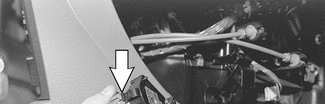

- Squeeze plastic clip (arrow) to release motor.
- Tilt motor out of housing.

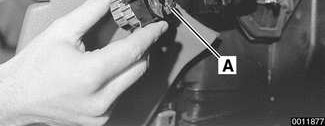

- During installation, be sure to align air distribution flap and motor drive (**A**).

## Right side air distribution motors, accessing

Four of the air distribution motors are under the right side of the dashboard:

- Right side fresh air/recirculation
- Defroster
- Ventilation flaps
- Right footwell vent

- Remove glove compartment and right footwell trim panel for access. See [513 Interior Trim].

> **CAUTION!**
> - Disassemble interior trim carefully to avoid damage.

- Disconnect negative (-) battery cable in trunk.

> **CAUTION!**
> - Prior to disconnecting the battery, read the battery disconnection cautions given at the front of this manual on page viii.

Right side fresh air/recirculation motor (arrow):

- For access, remove right footwell duct as described below.
- Unhook linkage, then remove motor.

Defroster air distribution motor (arrow)

Ventilation distribution motor (arrow)

- For access, remove defroster air distribution motor.

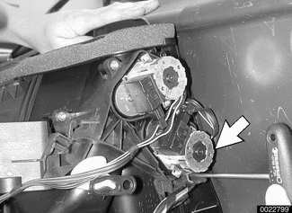

Right footwell vent air distribution motor (arrow):

- For access, remove passenger side airbag as described in [721 Airbag System (SRS)].

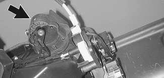

- Unhook linkage, then remove motor.

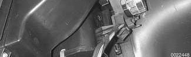

## Left side air distribution motor, accessing

The fresh air distribution motor is under the left side of the dashboard. Remove the left footwell (pedal cluster) trim panel for access.

> **CAUTION!**
> - Disassemble interior trim carefully to avoid damage.

- Move steering column to maximum extended position.

Working at trim panel, remove fasteners.

- Note locking clips (**A**) which must be rotated 90° to remove.
- Remove mounting screws (**B**).
- Unhook retaining clip from steering column lower trim.
- Detach electrical harness connectors from footwell light and speaker (if equipped).
- Release OBD II socket from panel and pull out.

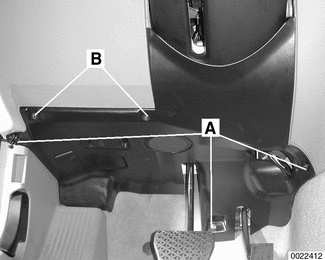

Reach up above accelerator pedal to gain access to fresh air distribution motor (arrow).

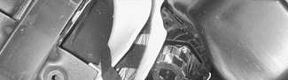

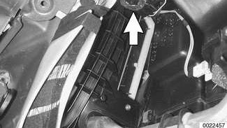

## Right footwell duct, removing and installing

- Remove glove compartment as described in [513 Interior Trim].
- Remove IHKA control panel or GPS On-Board Monitor, as applicable (described below).

Reach through control panel opening to detach air duct locking clip (arrow) from heater/evaporator housing.

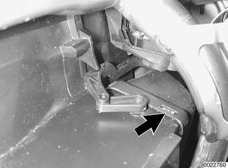

- Separate bottom of air duct from rear compartment duct.
- Pull forward and down to remove.
- Installation is reverse of removal.

## Dashboard vent, removing and installing

Pry gently at dashboard trim to remove.

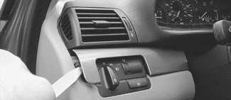

> **CAUTION!**
> - To avoid marring interior trim, work with a plastic prying tool.

Remove air vent mounting screws (arrows).

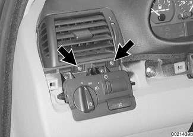

- Lift vent slightly and withdraw from dashboard.
- Installation is reverse of removal.

**Note:**

- *Removal of right or center dashboard vent is similar.*
- *To fully remove the center dashboard vent, use pliers to detach control cable housing and remove from control lever.*
- *Remove trim on right side prior to removing center trim.*
