# Washer Systems

> Source: Bentley *BMW 3 Series (E46) 1999–2005 (M3) Repair Manual*, section 611-4 (PDF pages 1048–1053 of 1252).

The windshield washer system includes the heated spray nozzles in the engine hood, the washer fluid pump, and the washer fluid reservoir in the front passenger side of the engine compartment.

The headlight washer system (optional) consists of the front washer fluid tank (shared with the windshield washer system), a separate washer pump and spray nozzles in the front bumper.

The rear window washer system (Sport Wagon only) consists of a washer tank and pump in the right side cargo compartment behind a trim panel and a spray nozzle at the top of the rear window frame.

## Windshield spray nozzle, removing and installing

Working under open engine hood, gently squeeze retaining clips (arrows) on nozzle sides to free nozzle from plastic intake grille.

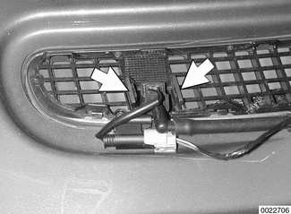

- Carefully disconnect hose from nozzle. Disconnect harness connector for nozzle heater.

Installation is reverse of removal:

- Check and adjust nozzles before driving. Use diagram.

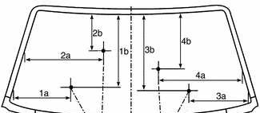

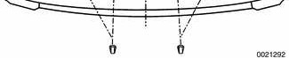

- 1a - 265 mm (10.4 in.)
- 1b - 445 mm (17.5 in.)
- 2a - 400 mm (15.7 in.)
- 2b - 270 mm (10.6 in.)
- 3a - 260 mm (10.2 in.)
- 3b - 550 mm (21.7 in.)
- 4a - 500 mm (19.6 in.)
- 4b - 350 mm (13.8 in.)

**Note:**

> The windshield spray nozzles can be aimed by using a sewing needle or a similar diameter stiff piece of wire.

## Headlight washer spray nozzle, removing and installing

**Note:**

> Headlight nozzles are marked L or R on the underside. Do not mix them up.

- Prior to removal, cover spray nozzle with shop rag. Wash water drains out.
- Gently pry out spray nozzle and pull out to stop. Tug on nozzle to detach from washer fluid duct.
- Transfer trim to new nozzle before installing.
- Snap new nozzle on fluid duct by pushing into opening. Check to make sure nozzle is fully snapped into place.

Using BMW special tool 00 9 100 or equivalent, adjust headlight washers so that spray jets strike approximately in center of each beam (arrows).

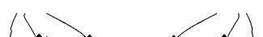

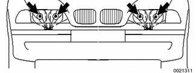

**Note:**

> To turn on headlight washer jets, turn on ignition, lights and windshield washer system. To repeat spray procedure, turn off ignition, then back on again. Otherwise the headlight washers are disabled for 3 minutes.

## Front washer fluid reservoir and washer fluid pumps, replacing

- Open hood and siphon washer fluid from reservoir.

Detach washer fluid level sensor harness connector (A) in front bottom of fluid reservoir. Remove reservoir retaining screw (arrow).

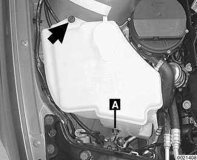

Lift reservoir. Pry gently at retaining clip (arrow) on heat shield to disengage from reservoir.

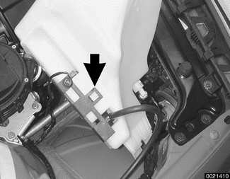

- Cut off wire tie to release washer pump harness from heat shield. Lay heat shield aside.
- To remove windshield washer pump (arrow) and headlight washer pump if equipped:
    - Disconnect electrical connection at pump.
    - Twist pump clockwise.
    - Pull pump out of reservoir.

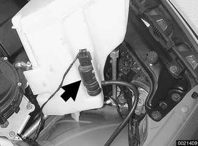

- Installation is reverse of removal, noting the following:
    - Twist washer fluid level sensor clockwise to remove from base of reservoir.
    - Transfer reservoir cover and strainer to new container.
    - Coat fluid pump sealing ring with anti-friction agent.
    - On installation check that fluid hoses are not kinked.
    - Make sure reservoir heat shield is correctly engaged. Replace wire tie.
    - Refill reservoir.

## Front washer fluid level sensor, replacing

Remove front washer fluid reservoir:

Twist washer fluid level sensor (arrow) clockwise to remove from base of reservoir.

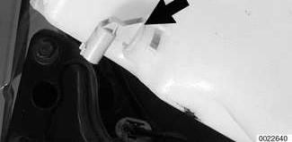

- Installation is reverse of removal.

## Rear window spray nozzle, removing and installing (Sport Wagon)

- Use plastic prying tool to lever nozzle out of rubber strip at top of rear window.
- Push new nozzle into rubber strip.

Adjust nozzle spray pattern using alignment specifications.

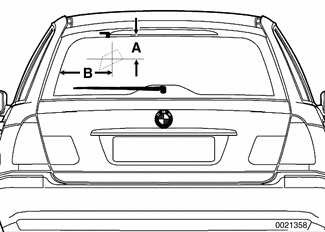

| Rear window spray nozzle alignment specifications | |
|---|---|
| A | 100 mm (3.9 in.) |
| B | 320 mm (12.6 in.) |

## Rear window washer fluid reservoir, replacing (Sport Wagon)

- Working in right rear cargo area, remove side trim panel, then remove sound insulation.
- Siphon out washer fluid reservoir.

To remove tank:

- Detach filling and pressure hoses (A).
- Remove washer pump electrical harness connector (B).
- Loosen mounting nuts at bottom of tank (C) slightly.
- Remove top mounting nut (D) and remove reservoir.

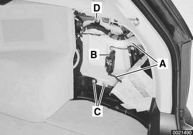

- To remove fluid pump:
    - Detach electrical harness connector (B).
    - Pry pump gently outward and up to remove from tank.
- When installing:
    - Coat pump sealing ring with anti-friction agent.
    - Make sure hoses are not kinked.
    - Refill reservoir.
