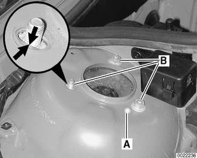
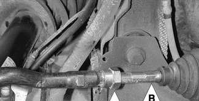
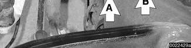
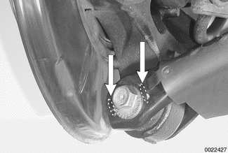
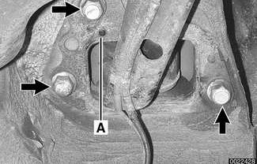

# Wheel Alignment

> Source: BMW 3 Series (E46) Repair Manual, section 320-5, Steering and Wheel Alignment chapter (PDF pages 618–622 of 1252).

Proper handling, stability, tire wear and driving ease depend upon the correct alignment of all four wheels. The front axle is aligned in relation to the rear axle, then the front wheels are aligned in relation to one another. This is known as a four-wheel or thrust-axis alignment.

The BMW E46 uses a sophisticated multi-link suspension at the front and rear of the car. Proper alignment requires computerized alignment equipment.

Alignment specifications only apply under the following conditions:

- Correct wheels and tires are installed, in good condition, and are at the correct inflation pressures.
- All steering and suspension parts and bushings are undamaged and show no signs of abnormal wear.
- Wheel bearings are in good condition.
- Ride height is in accordance with specifications. See [300 Suspension, Steering and Brakes-General]
- Car is in normal loaded position. See [Table a. Front wheel alignment specifications] and [Table b. Rear wheel alignment specifications].

> **WARNING!**
>
> While performing alignment procedures, make sure the car is stable and well supported at all times. Use a professional automotive lift or jack stands designed for the purpose. A floor jack is not adequate support.

| Normal loaded position |  |
|---|---|
| Each front seat | 68 Kg (150 lb) |
| Rear seat (center) | 68 Kg (150 lb) |
| Trunk | 21 Kg (46 lb) |
| Fuel tank | full |

Table a. Front wheel alignment specifications

| Parameter | Standard suspension | All wheel drive suspension | Sport suspension | Rough road suspension |
|---|---|---|---|---|
| Toe angle (total) | 0° 14' ± 8' | 0° 14' ± 8' | 0° 14' ± 8' | 0° 14' ± 8' |
| Camber (difference between left/right max. 30') | -20' ± 20' | 20' ± 20' | 43' ± 20' | +8' ± 20' |
| track differential angle with 20° lock on inside wheel | -1° 34' ± 30' | -53' ± 30' | -1° 34' ± 30' | -1° 34' ± 30' |
| Caster (difference between left/right max. 30') with 10 wheel lock | 5° 26' ± 30' | 5° 27' ± 30' | 5° 36' ± 30' | 5° 17' ± 30' |
| Caster (difference between left/right max. 30') with 20 wheel lock | 5° 37' ± 30' | 5° 37' ± 30' | 5° 47' ± 30' | 5° 27' ± 30' |
| Front wheel displacement | 0° ± 15' | 0° ± 15' | 0° ± 15' | 0° ± 15' |

Note: a single value repeated across the row applies to all suspension types (merged cell in the source table).

Table b. Rear wheel alignment specifications

| Parameter | Standard suspension | All wheel drive suspension | Sport suspension | Rough road suspension |
|---|---|---|---|---|
| Toe angle (total) | 0° 16' ± 6' | 0° 16' ± 6' | 0° 16' ± 6' | 0° 16' ± 6' |
| Camber (difference between left/right max. 15') maximum allowable deviation between sides | -1° 30' ± 15' | -1° 15' ± 15' | -2° 04' ± 15' | -46' ± 15' |
| Geometrical axis deviation | 0° ± 6' | 0° ± 6' | 0° ± 6' | 0° ± 6' |

Note: a single value repeated across the row applies to all suspension types (merged cell in the source table).

## Front wheel camber

Any change to the camber will also change the toe setting. Always adjust camber prior to adjusting toe.

Front wheel camber adjustment can be made by driving out factory strut alignment pin (A) in upper strut housing.

- Loosen upper strut mount nuts (**B**).
- Use BMW special tool 32 3 140 to adjust position of upper strut mount studs in slotted holes (**arrows**).

| Tightening torque |  |
|---|---|
| Upper strut mount to body | 24 Nm (17 ft-lb) |

## Front wheel toe

Front wheel toe is adjusted at tie rod ends:

- Loosen tie rod lock nut (**A**).
- Adjust tie rod by turning inner tie rod (**B**) to change length.

**Note:** *Steering rack can be centered by aligning centering mark on steering shaft with lug on steering rack.*

- To keep steering wheel centered, adjust both tie rods equal amounts.
- Make sure the rubber boot on the rack moves freely on the tie rod and does not become twisted.

| Tightening torque |  |
|---|---|
| Tie rod lock nut | 45 Nm (33 ft-lb) |

## Rear wheel camber

Rear wheel camber is adjusted at outer end of rear lower control arm using camber adjusting bolt.

- Make sure bolt remains between two alignment lugs (**arrows**) on end of control arm.
- Check toe setting as described below.

| Tightening torque |  |
|---|---|
| Rear lower control arm to rear trailing arm | 77 Nm (57 ft-lb) |

## Rear wheel toe

- Loosen trailing arm bracket mounting bolts (**arrows**).

- Install BMW special tool 32 3 030 over alignment lug (**A**) and adjacent bolt.
- Use tool to adjust position of bracket.
- Remove tool and tighten trailing arm bracket mounting bolts.

| Tightening torque |  |
|---|---|
| Rear trailing arm bracket to body | 77 Nm (57 ft-lb) |
