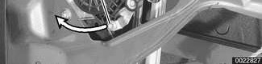
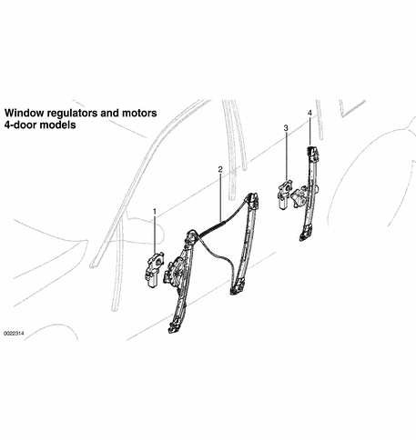
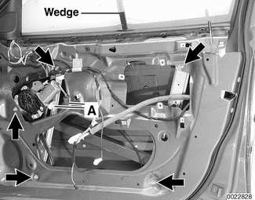
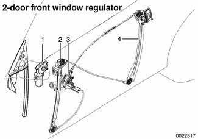

# Window Regulator Service

> Source: BMW 3 Series (E46) Repair Manual, section 512-4, Door Windows chapter (PDF pages 826–831 of 1252).

> **WARNING!**
> - E46 cars are fitted with side-impact airbags in the front doors. Some are equipped with airbags in the rear doors as well. When servicing the door windows on cars with side-impact airbags, always disconnect the negative (-) battery cable. See [721 Airbag System (SRS)] for cautions and procedures relating to the airbag system.
> - Prior to disconnecting the battery, read the battery disconnection cautions given at the front of this manual on page viii.

## Window regulator motor

> **Note:**
> - Because window operation is electronically controlled, a window motor does not have mechanical end positions. For this reason it can be removed and installed with the window in any position and does not need reinitialization.

To remove motor:

- Remove inner door panel and vapor barrier.
- Detach window motor electrical harness connector (A).
- Remove motor mounting bolts (B).
- Twist motor slightly (arrows) to clear window regulator mounting tabs.

When reinstalling:

- Make sure window has not travelled fully downward.
- Manipulate spring-loaded window control cable (C) to engage motor teeth to regulator gears.

## Window regulators and motors, 4-door models, assembly

1. Front window motor
2. Front window regulator
3. Rear window motor
4. Rear window regulator

## Window regulator and motor, removing and installing (4-door models)

Sedan and Sport Wagon doors are similar. There are two window rails in each front window regulator, only one in the rear. Otherwise the front and rear regulators are similar.

> **Note:**
> - BMW recommends removing the window regulator and motor as one unit, then separating the two on the bench.

- Remove door panel as described in [411 Doors].
- Disconnect battery negative cable and remove side impact air bag, if applicable. See [721 Airbag System (SRS)].

> **WARNING!**
> - E46 cars are fitted with side-impact airbags in the front doors. Some are equipped with airbags in the rear doors as well. When servicing the door windows on cars with side-impact airbags, always disconnect the negative (-) battery cable. See [721 Airbag System (SRS)] for cautions and procedures relating to the airbag system.
> - Prior to disconnecting the battery, read the battery disconnection cautions given at the front of this manual on page viii.

- Remove vapor barrier.
- Detach window from window regulator as described earlier. Do not remove window from door. Push window up and use wedge to hold in position.

- Detach window regulator from door:
    - Disconnect electrical harness connector (A) to power window motor.
    - Remove regulator mounting nuts (arrows).

- Remove window regulator through opening in bottom of door, checking for any wiring harnesses that might become snagged during removal.

- Installation is reverse of removal. Be sure to route wiring harnesses to keep them away from moving window mechanism. Use new wire ties as necessary. Adjust front window as described earlier.

Tightening torques

| Component | Torque |
|---|---|
| Window motor to regulator | 5 Nm (4 ft-lb) |
| Window regulator to door | 9 Nm (7 ft-lb) |
| Window to guide | 8 Nm (71 in-lb) |

## Door window regulator and motor, removing and installing (2-door models)

- Remove door panel as described in [411 Doors].
- Disconnect negative (-) cable from battery. Then remove airbag unit and vapor barrier from door. See [721 Airbag System (SRS)].
- Remove door glass as described earlier.
- Lower window regulator completely.

> **WARNING!**
> - Once the window regulator is positioned correctly, disconnect harness connector from power window motor to prevent accidental operation of the mechanism.

- Detach window regulator from door:

1. Window motor
2. Front window rail
3. Window regulator mechanism
4. Rear window rail

    - Disconnect electrical harness connector to power window motor.
    - Remove regulator mounting nuts.

- Remove window regulator through opening in bottom of door, checking for any wiring harnesses that might become snagged during regulator removal.

- Installation is reverse of removal, noting the following:

    - Inspect rubber insulators. Replace if brittle.
    - After inserting window regulator into door cavity, install and tighten down mounting nuts on rear window rail.
    - Install front window rail mounting nuts but do not tighten.
    - Install glass. See [Front door window, removing and installing (2-door models)].
    - Tighten upper nut of front rail.
    - Lower window glass fully.
    - Tighten front rail lower nuts.
    - Adjust window. See [Front door window, adjusting (2-door models)].

Tightening torques

| Component | Torque |
|---|---|
| Window motor to regulator | 5 Nm (4 ft-lb) |
| Window regulator to door | 9 Nm (7 ft-lb) |
| Window to guide | 8 Nm (71 in-lb) |
