# Window Service, 2-door Models

> Source: BMW 3 Series (E46) Repair Manual, section 512-3, Door Windows chapter (PDF pages 813–825 of 1252).

2-door models are equipped with the "close with door shut" feature. In this mode, the window glass moves down slightly when the door latch is activated, then jams up tightly against the weather-strip when the door is fully closed.

> **WARNING!**
> - E46 cars are fitted with side-impact airbags in the front doors. When servicing the door windows on cars with side-impact airbags, always disconnect the negative (-) battery cable. See [721 Airbag System (SRS)] for cautions and procedures relating to the airbag system.
> - Prior to disconnecting the battery, read the battery disconnection cautions given at the front of this manual on page viii.

## Front door window, adjusting (2-door models)

The "close with door shut" feature of 2-door cars with frameless windows makes window adjustment critical.

> **CAUTION!**
> - There is risk of window glass breakage if correct adjustment procedures are not used. If in doubt, this procedure should be left to a trained BMW technician.

The following adjustments can be made to the window:

- Longitudinal adjustment
- Pretension (or window rake)
- Parallelism (or window tilt)
- Vertical adjustment (or retraction depth)
- Glass protrusion (when open)
- Distance between side window and door window

### Emergency operation

Adjusting the "close with door shut" feature insures low wind noise and water leakage past windows. With the door closed, the window must jam a predetermined amount up into the seal. When the door is opened, the window must lower immediately to clear the seal.

- With door open, close window.
- To simulate closed door, use screwdriver or finger to push door lock rotary latch in direction of **arrow**.

- Window must rise to its full closed position.
- Close door as far as possible without forcing.
    - Coupe models: Top edge of glass must rest on door seal (**A**).
    - Convertible models: Gap between door and B-pillar (**B**) must be 25 mm (1 in.).

> **Note:**
> - Window must seal with water drain at mirror triangle in A-pillar.

- Use door handle to open rotary latch:
    - Window should lower a small amount.

- Close door:
    - Window should raise a small amount.

- Reopen door:
    - Window should lower a small amount and clear rubber seal.

- If window gets stuck in rubber seal:
    - Lower glass.
    - Adjust retraction depth as described later.

### Longitudinal adjustment

- Position window approx. 155 mm (6.1 in.) above dead bottom.

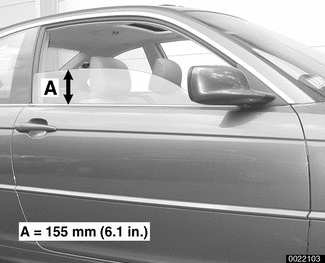

- Working carefully with a plastic prying tool, detach outside trim strip from door.

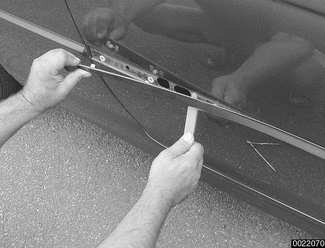

- Reach through door bores (**A**) using Torx driver E7 on extension with ratchet wrench (BMW special tool 41 6 120 or equivalent). Loosen but do not remove longitudinal adjustment screws.

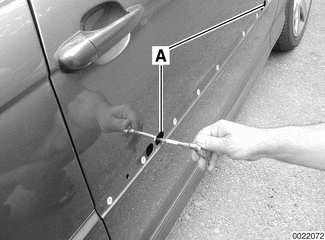

- Raise glass to top. Move glass fore or aft to attain correct adjustment.

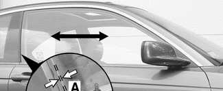

    - Coupe models: When fully closed, rear edge of window must protrude by distance **A** from edge of window outer sealing lip.
    - If necessary, replace side window trim.

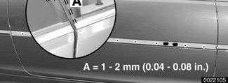

Window longitudinal adjustment

| Window longitudinal adjustment | |
|---|---|
| Dimension A | 1 - 2 mm (0.04 - 0.08 in.) |
| Door window rear edge to side window seal (Coupe) | 6 ± 0.75 mm (0.24 ± 0.03 in.) |

- Convertible models: When all the way up, measure door window gap to side window trim.

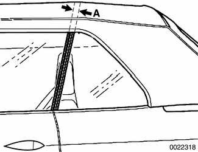

    - Gap **A** is measured from edge of door window to rear of side window seal.

Window longitudinal adjustment

| Window longitudinal adjustment | |
|---|---|
| Door window rear edge to side window seal (Convertible) | 25 mm (1 in.) |

- Tighten longitudinal adjustment screws.

Tightening torque

| Tightening torque | |
|---|---|
| Window to guide | 8 Nm (71 in-lb) |

### Pretension

> **Note:**
> - Window pretension can also be thought of as the inward rake of the window.

- Remove outer door trim strip as described earlier.

- Latch door to first catch of door lock (**A**). Check that top of window rests on rubber door seal (**B**).

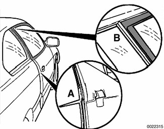

- Reach through rear bore in door with BMW special tool 41 6 120 or equivalent ratchet wrench.
- Loosen window adjustment Torx screw (**A**) 180° counterclockwise.
- Turn slider adjustment nut (**B**) until it is hard to move.
- Continue loosening window adjustment Torx screw and tightening slider adjustment nut (see previous step) until correct window rake is reached.
- Tighten window adjustment screw.

Tightening torque

| Tightening torque | |
|---|---|
| Window to guide | 8 Nm (71 in-lb) |

### Vertical adjustments

> **Note:**
> - Adjusting the depth that the window retracts into the door seal insures that wind noise and water leakage past window is kept to a minimum.

- Parallelism. Top edge of door window must be parallel to contour of water drain in roof.

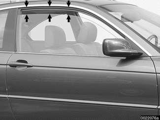

> **Note:**
> - Window parallelism is also referred to as window tilt.

- Retraction depth. With door closed, raise window to top.
    - Use BMW special tool 51 3 080 or equivalent device to measure depth of window in rubber seal.

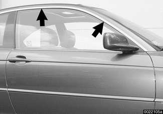

Window retraction

| Window retraction | |
|---|---|
| At A-pillar or roof line (**arrows**) | 3 - 4 mm (0.12 - 0.16 in.) |

- Window protrusion. When all the way down, measure door window glass protrusion above top edge of door.

Window protrusion

| Window protrusion | |
|---|---|
| Door window above top of door | max. 2 mm (0.08 in.) |

- To adjust:
    - Lower door glass.
    - Pry out rubber plugs at base of door.
    - Starting at rear of door, reach through bore in door to turn Torx screw (**A**).

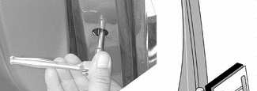

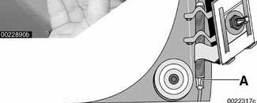

> **Note:**
> - Torx screw size is T20.

    - Repeat at front bore.
    - Raise window and check for parallelism and correct depth of retraction.
    - Repeat as necessary.
    - Reinsert rubber plugs.

## Front door window, removing and installing (2-door models)

- Remove interior door panel. See [411 Doors].

- Disconnect negative (-) cable from battery. Then remove airbag unit and vapor barrier from door. See [721 Airbag System (SRS)].

> **WARNING!**
> - Prior to disconnecting the battery, read the battery disconnection cautions given at the front of this manual on page viii.

- Detach door corner rubber seal mounting clips (**arrows**). Remove seal by pulling up in direction of curved **arrow**.

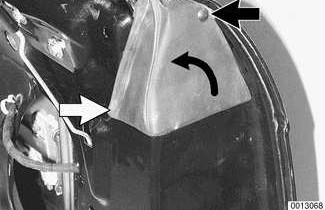

- Lift off window inner lip seal.

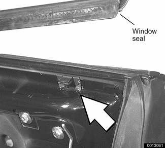

- If necessary, replace any defective retaining clip (**arrow**).

- Position door window approximately 80 mm (3.15 in.) below roofline. If necessary, temporarily reconnect battery cable.

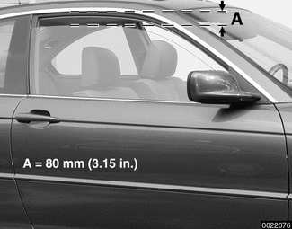

> **WARNING!**
> - Once the window is lowered, disconnect harness connector from power window motor to prevent accidental operation of the window.

- Remove window mounting screws from window regulator rails.

> **Note:**
> - Window mounting screws have left-hand thread.

- Window rear mounting hardware will stay with glass.

- Tilt rear edge of window glass up and out of door.

- If glass is being replaced, transfer window rear mounting hardware (mounting shim, threaded sleeve and clamping retainer) from lower rear corner of glass to new window.

- Installation is reverse of removal.
    - Install window rear mounting screw with adjusting sleeve through guide rail and threaded sleeve in glass.

> **Note:**
> - Window mounting screws have left-hand thread.

    - Use new mounting bolts when reinstalling side-impact airbag to door.
    - Adjust window as described earlier.

Tightening torque

| Tightening torque | |
|---|---|
| Side-impact airbag to door | 8.5 Nm (75 in-lb) |
| Window to guide | 8 Nm (71 in-lb) |

## Rear vent window or vent latch, (Coupe models)

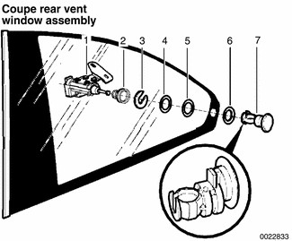

Refer to accompanying illustration when removing Coupe rear vent window or vent latch mechanism.

1 - Vent window drive

2 - Inner cap

3 - Retainer

4 - Washer

5 - Washer

6 - Shim

7 - Glass support

When installing, make sure U-shaped opening in glass support points to rear of car.

To access rear vent hinges, remove B pillar (door pillar) trim.

When reinstalling make sure window seals completely. Note gap clearances below.

Vent window clearances

| Vent window clearances | |
|---|---|
| Front trim strip to rear edge of front window | up to 6 mm (0.24 in.) |
| Rear of window to water drain | up to 1.8 mm (0.07 in.) |
| Top of window to water drain | 1 mm (0.04 in.) |

Tightening torques

| Tightening torques | |
|---|---|
| Vent window to body (M6 nut) | 6.2 Nm (55 in-lb) |

## Rear side window (Convertible models)

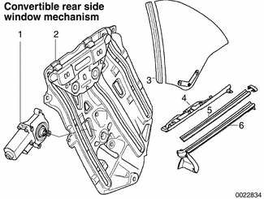

Refer to accompanying illustration when removing Convertible rear window or window motor.

1 - Window motor

2 - Window regulator assembly

3 - Window glass

4 - Insert

5 - Inner seal

6 - Outer seal

> **CAUTION!**
> - Convertible rear window removal, installation and adjustment is complex. If the final adjustment is incorrect glass breakage may result. This job is best left to be done by a trained technician at a qualified BMW repair facility.

## Rear side window, adjusting (Convertible models)

The Convertible rear side window shares a version of "close with door shut" feature of the front window: It retracts slightly when the top is raised or lowered, then rises to seal against the folding top once the top is locked in place.

The procedure for setting Convertible rear side window adjustment, while similar in principle to front window adjustment, also depends on correct adjustment of the folding top and of the front window glass.

Refer to the accompanying illustration when adjusting Convertible side window.

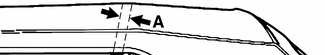

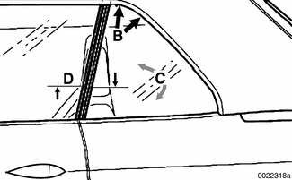

- Distance to front door window (longitudinal adjustment) (**A**) must be set by loosening Torx bolt through bore in outer shell of car, after removing exterior side trim strip.
- To set retraction depth (submersion) into top rubber seal (**B**), rear interior side trim panel must be removed to access adjustment screws.
- To set window centering (**C**), rear interior side trim panel must be removed to access adjustment screws.
- To set side window depth in relation to door window (**D**), rear interior side trim panel must be removed to access adjustment screws.

Convertible rear side window adjustments

| Convertible rear side window adjustments | |
|---|---|
| A | 23 - 25 mm (0.9 - 1.0 in.) |
| B | Window must run into convertible top seal when top is closed. With top open, glass must rest firmly against window seal. |
| C | With convertible top open, window must be centered in channel |
| D | up to 1 mm (0.04 in.) toward inside of car |
