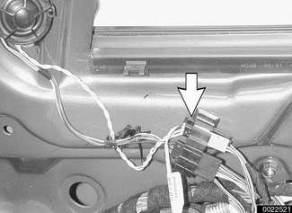
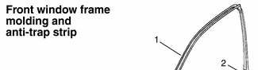
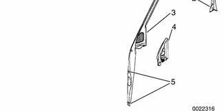
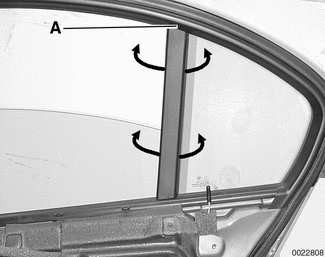
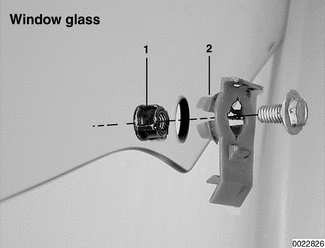
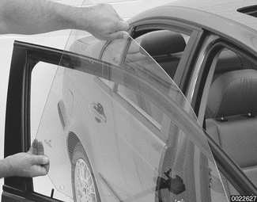
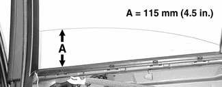
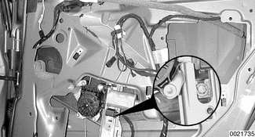

# Window Service, 4-door Models

> Source: BMW 3 Series (E46) Repair Manual, section 512-2, Door Windows chapter (PDF pages 805–812 of 1252).

Sedan and Sport Wagon doors are similar. Use the following procedures for window service on these models.

> **WARNING!**
> - E46 cars are fitted with side-impact airbags in the front doors. Some are equipped with airbags in the rear doors as well. When servicing the door windows on cars with side-impact airbags, always disconnect the negative (-) battery cable. See [721 Airbag System (SRS)] for cautions and procedures relating to the airbag system.
> - Prior to disconnecting the battery, read the battery disconnection cautions given at the front of this manual on page viii.

## Window anti-trap strip, testing

- To test function of anti-trap strip on any window:
    - With key ON and window down, pull up window switch to second detent, thus activating one-touch close operation.
    - Insert wooden block or other soft object between glass and upper door frame.
    - Window should contact block, then immediately reverse direction and lower by approx. 25 mm (1 in.).

> **Note:**
> - Anti-trap strip is integrated into the molding strip of the door window frame.

## Front window anti-trap strip, removing

- Remove front door panel and vapor barrier as described in [411 Doors].

- Detach window frame molding strip and peel toward inside of vehicle.

- Separate anti-trap electrical harness connector (**arrow**) at top front of door.

> **Note:**
> - Wire colors for anti-trap strip are black-white.

- If replacing molding with new one, transfer mounting clips and foam insulation as necessary.

1 - Window frame molding

2 - Clip

3 - Door corner speaker cover

4 - Foam insulation

5 - Mounting clip

- After installation, recheck anti-trap protection.

## Rear window anti-trap strip, removing

- Remove rear door panel and vapor barrier as described in [411 Doors].

- Detach window frame molding strip, peeling it off fixed window partition (**arrows**). Do not tear strip in area **A**.

- Detach electrical harness connector at top front of door, just below window.

> **Note:**
> - Wire colors for anti-trap strip are black-white.

- After installation, recheck anti-trap protection.

## Front door window, adjusting (4-door models)

Whenever the front window or window regulator is removed, window adjustment should be checked. The glass should contact the top of the window squarely and should seat against the window seal uniformly.

> **Note:**
> - If the window does not contact the window seal uniformly, wind noise or water infiltration may result.

- Remove front door panel as described in [411 Doors].

- Disconnect negative (-) cable from battery. Then remove airbag unit and vapor barrier from door. See [721 Airbag System (SRS)].

> **WARNING!**
> - Prior to disconnecting the battery, read the battery disconnection cautions given at the front of this manual on page viii.

- Partially detach rear of vapor barrier/sound insulation from door and fold forward. Hold in place using adhesive tape.

- Loosen window guide rail mounting nuts (**arrows**), but do not remove.

- Reconnect battery. Open window fully.

- Tighten guide rail nuts.

Tightening torque

| Tightening torque | |
|---|---|
| Window regulator guide rail to door | 9 Nm (80 in-lb) |

## Front door window, removing and installing (4-door models)

- Remove front door panel as described in [411 Doors].

- Disconnect negative (-) cable from battery. Then remove airbag unit and vapor barrier from door. See [721 Airbag System (SRS)].

> **WARNING!**
> - Prior to disconnecting the battery, read the battery disconnection cautions given at the front of this manual on page viii.

- Detach window from window regulator rails:
    - Reattach battery. Move window to approx. 140 mm (5.5 in.) from bottom.
    - Remove window retaining screws (**insets**) at window regulator rails.

> **WARNING!**
> - Once the window is positioned correctly, disconnect harness connector from power window motor to prevent accidental operation of the window.

- Detach plastic window retainers from glass:
    - Push expander nut (**1**) out of plastic retainer.
    - Squeeze retainer tabs (**2**) and remove from glass.

> **Note:**
> - BMW recommends replacing the plastic window retainers every time the glass is removed from the door.

- Turn window glass carefully inside door cavity and lift out of door.

- Installation is reverse of removal.
    - Replace plastic window retainers once glass is inside door.
    - Use new mounting bolts when reinstalling side-impact airbag to door.
    - Adjust window as described earlier.

Tightening torque

| Tightening torque | |
|---|---|
| Side-impact airbag to door | 8.5 Nm (75 in-lb) |
| Window to regulator guide | 8 Nm (71 in-lb) |

## Rear door window, removing and installing (4-door models)

- Remove rear door panel and vapor barrier. See [411 Doors].

- In model with rear side impact airbag: Disconnect negative (-) cable from battery. Then remove airbag unit from door. See [721 Airbag System (SRS)].

- Detach window from window regulator rail:
    - If applicable, reattach battery. Move window to approx. 115 mm (4.5 in.) from bottom.

    - Remove window retaining screw (**inset**) at window regulator rail.

> **WARNING!**
> - Once the window is positioned correctly, disconnect harness connector from power window motor to prevent accidental operation of the window.

- Detach plastic window retainer from glass:
    - Push expander nut (**1**) out of plastic retainer.
    - Squeeze retainer tabs (**2**) and remove from glass.

> **Note:**
> - BMW recommends replacing the plastic window retainer every time the glass is removed from the door.

- Pull window glass straight up to lift out of door.

- Installation is reverse of removal.
    - Replace plastic window retainer once glass is inside door.
    - If applicable, use new mounting bolts when reinstalling side-impact airbag to door.
    - Rear window does not need adjustment.

Tightening torque

| Tightening torque | |
|---|---|
| Side-impact airbag to door | 8.5 Nm (75 in-lb) |
| Window to regulator guide | 8 Nm (71 in-lb) |
