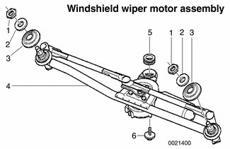
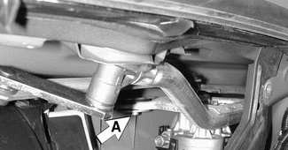
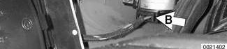
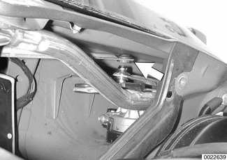
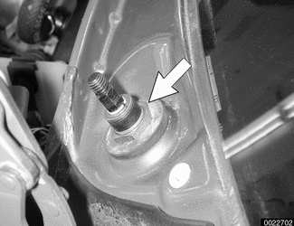
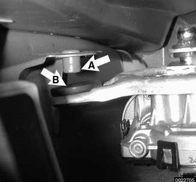
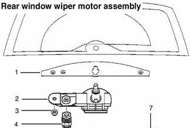
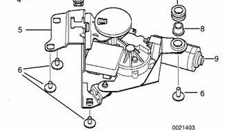
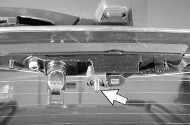

# Wiper Assemblies

> Source: Bentley *BMW 3 Series (E46) 1999–2005 (M3) Repair Manual*, section 611-3 (PDF pages 1042–1047 of 1252).

## Windshield wiper assembly, removing and installing

The windshield wiper assembly (linkage and motor) is removed as a single unit. Once the assembly is removed, the wiper motor and other linkage parts can be repaired or replaced.

- 1 - Wiper assembly mounting nut - tighten to 10 Nm (88 in-lb)
- 2 - Washer
- 3 - Damping ring
- 4 - Motor and rod assembly
- 5 - Rubber damper
- 6 - Center mounting bolt - tighten to 10 Nm (88 in-lb)

**Note:**

> BMW does not provide the windshield wiper motor as a separate component.

- It may be necessary to raise the hood to the service position to access the wiper arm fasteners. See [410 Fenders, Engine Hood].

> **CAUTION!**
>
> - Make sure wipers are parked (stalk switch in OFF position) and the ignition is also OFF.
> - Use fender cover to protect windshield.
> - To avoid damaging the wiper arms and pivots, do not manually slide or force the wiper arms across the windshield.

- Remove wiper arms as described earlier.
- Remove housing for microfilter for interior ventilation. Remove upper cover and microfilter.
- Open wiring harness loom (A) and remove wires. Unfasten screws (B) and remove lower microfilter housing.

- Remove heater bulkhead cover.
- Remove engine compartment side trim panel. Turn locking knobs (A) and slide trim panel from mounting lip.
- Remove heater bulkhead cover mounting screws (B) and lift cover up and out from firewall.

- Detach wiper assembly inside cowl:
    - Remove assembly center mounting bolt (A).

    - Disconnect electrical harness connector (B).

- Remove right side wiper rod (arrow) from transmission arm.

- Release retaining clips and remove windshield base trim tray.
- Remove large nuts (arrow) at base of wiper arm shafts in cowl panel. Remove assembly.

**Note:**

> Cover inside edges of cowl panel sheet metal with thick tape to prevent damage during wiper assembly removal.

Installation is reverse of removal, noting the following:

- Fit center mounting rubber damper over pin (A) into wiper motor mounting arm (B).

- Install all fasteners finger-tight first.
- Once installed, wiper motor should first be run to parked position and switched off.
- Next, install wiper arms but not blades.
- Close hood and fit wiper blades.
- Recheck wiper blade position as described earlier under [Wiper arms, removing and installing].
- Check all electrical harness fittings and sealing grommets for correct reinstallation. Replace any wire ties cut off during removal.

Tightening torques:

| Component | Torque |
|---|---|
| Center wiper assembly mount to cowl | 10 Nm (88 in-lb) |
| Wiper arm to wiper shaft | 30 Nm (22 ft-lb) |
| Wiper shaft nut at cowl | 10 Nm (88 in-lb) |

## Rear window wiper motor, removing and installing (Sport Wagon)

- Remove rear deck interior trim panel.
- Detach electrical harness connector(s) and remove screws mounting motor assembly to rear deck lid. Remove motor assembly.

- 1 - Plastic trim
- 2 - Rear wiper pivot assembly
- 3 - Nut M6 - tighten to 9.5 Nm (7 ft-lb)
- 4 - Mechanical coupling
- 5 - Wiper motor assembly
- 6 - Torx bolt M6 - tighten to 9.5 Nm (7 ft-lb)
- 7 - Damper ring
- 8 - Mounting sleeve
- 9 - Rear wiper motor assembly

- To install:
    - Remove rear window lock assembly from rear deck.
    - Install wiper motor assembly and thread mounting bolts finger tight.
    - Place BMW special tool 61 1 330 on rear window wiper drive and close rear window.
    - With rear wiper vertical, allow rear wiper shaft mechanical coupling to snap into special tool bore.
    - Tighten down wiper motor assembly.
    - Remove special tool.
    - Remainder of assembly is reverse of removal.

Tightening torque:

| Component | Torque |
|---|---|
| Wiper motor to rear deck (Torx) | 9.5 Nm (7 ft-lb) |

## Rear window wiper shaft, removing and installing (Sport Wagon)

- Remove rear wiper arm.
- Lift rear window and remove wiper shaft housing plastic trim covers.
- Remove housing mounting nuts. Remove housing.
- Slacken rear window lift nut.
- Remove wiper shaft assembly mounting nut (arrow). Pull shaft and bearing out of housing.

- Installation is reverse of removal. Adjust wiper arm position as described earlier.

Tightening torques:

| Component | Torque |
|---|---|
| Rear window button to rear window | 9.5 Nm (7 ft-lb) |
| Wiper arm to wiper shaft | 9.5 Nm (7 ft-lb) |
| Wiper shaft housing to rear window | 9.5 Nm (7 ft-lb) |
