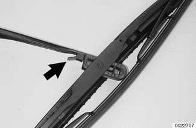
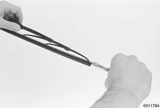
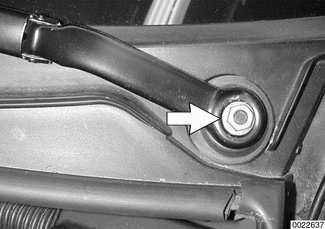
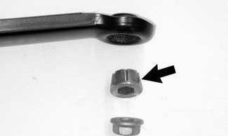

# Wiper Blades

> Source: Bentley *BMW 3 Series (E46) 1999–2005 (M3) Repair Manual*, section 611-2 (PDF pages 1037–1041 of 1252).

## Wiper blade cleaning problems

Common cleaning problems with the wipers include streaking or sheeting, water drops after wiping, and blade chatter.

> **CAUTION!**
>
> - Never turn on the wiper blades while the hood is open. Damage to the wiper system and hood may occur.
> - To ensure safety during wiper system repair procedures, remove the windshield wiper fuse. See [610 Electrical Component Locations].

Streaking is usually caused when wiper blades are coated with road film or car wash wax. Clean the blades using soapy water. If cleaning does not cure the problem, the blades should be replaced. BMW recommends replacing the wiper blades twice a year, before and after the cold season.

Water drops that remain behind after wiping are usually caused by oil, road film, or diesel exhaust residue on the glass. Use an alcohol or ammonia solution or a non-abrasive cleaner (such as Bon-Ami®) to clean the windshield.

Chatter may be caused by dirty or worn blades, or by wiper arms that are out of alignment. Clean the blades and windshield as described above. Adjust the wiper arm so that there is even pressure along the blade, and so that the blade at rest is perpendicular to the windshield. If problems persist, the blades and wiper arms should be replaced.

**Note:**

> BMW has available a special tool/gauge (BMW special tool 00 9 210) to align the angle of the wiper arm to the windshield glass.

The wiper blades can be renewed in one of two ways:

- Complete blade replacement
- Rubber insert replacement

Insert replacement is the most economical method, although over time the wiper blade itself will become worn. One rule of thumb would be to replace just the inserts every second time.

## Wiper blades, replacing

To replace wiper blades:

- Pivot wiper arm off windshield.
- Position wiper blade approximately perpendicular to wiper arm.
- Remove wiper blade from wiper arm by depressing retaining tab (arrow) and sliding blade out of arm.

- Installation is reverse of removal.
- Install wiper blade to wiper arm until retaining tab can be heard to click into position.

**Note:**

> Some wiper blade versions may have two retaining tabs.

## Wiper blade inserts, replacing

To replace wiper inserts:

- Remove wiper blade as described earlier.
- Unhook wiper blade insert from wiper arm guide. If necessary, guide slightly using needle nose pliers.
- Pull old insert from wiper arm guides, noting installation position.
- Remove metal support strips from old insert and install into slots in new insert, noting installation direction of cutouts in support strips.
- Slide new insert through wiper blade guides. Lock insert in place at end guides.

**Note:**

> The notched cutouts in the retaining strips should engage the molded notches in the inserts.

## Wiper arms, removing and installing

**Note:**

> Wiper arm removal and installation on the Sport Wagon rear window is similar to the operation on the front wiper arms.

- It may be necessary to raise the engine hood to the service position to access the front wiper arm fasteners. See [410 Fenders, Engine Hood].

> **CAUTION!**
>
> - Make sure wipers are parked (stalk switch in OFF position) and the ignition is also OFF.
> - Use fender cover to protect windshield.

- With engine hood in closed position, remove both wiper blades.
- Open hood. Gently pry off caps covering wiper arm retaining nuts.
- Remove each wiper arm retaining nut (arrow). Detach arm from shaft.

**Note:**

> Use BMW special tool 61 6 060 or equivalent puller to remove arm.

- If wiper arm sleeve (arrow) at shaft is loose, it must be replaced.

- Install arms and thread nuts on loosely. Torque nuts after installing wiper blades.

Tightening torque:

| Component | Torque |
|---|---|
| Front wiper arm to wiper shaft | 30 Nm (22 ft-lb) |
| Rear wiper arm to wiper shaft | 9.5 Nm (7 ft-lb) |

- Check to make sure blades are positioned correctly. Front wiper arms should be installed with tips to the right (passenger) side of the vehicle. Measure distance of wiper arms from lower portion of window gasket with wiper blades installed before tightening to correct torque.

Wiper blade park position:

| Blade | Tip distance |
|---|---|
| **Front wiper blade tip distance from windshield gasket** | |
| Right blade | 24 mm (1 in.) |
| Left blade | 44 mm (1.7 in.) |
| Rear wiper blade tip distance from rear window gasket | 12 mm (1/2 in.) |
